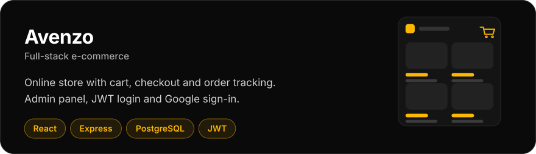
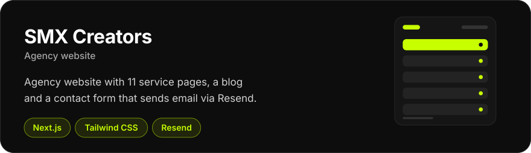
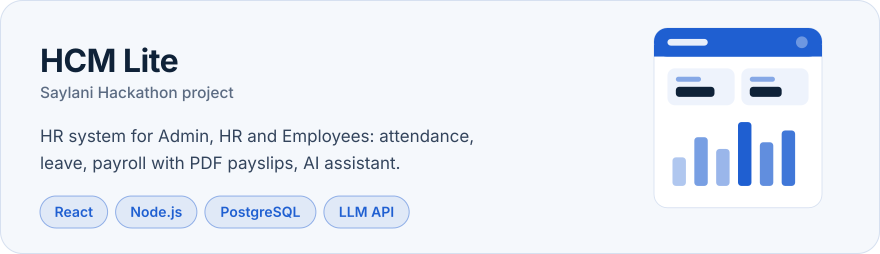
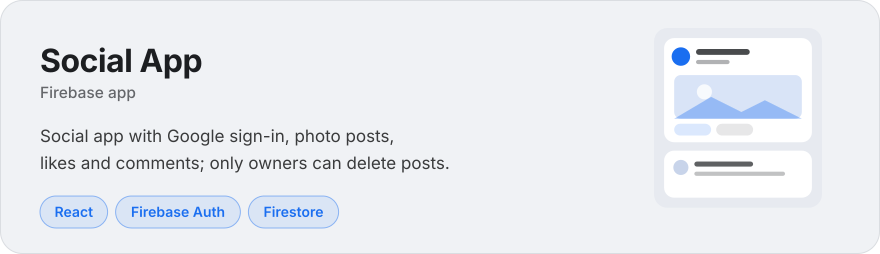
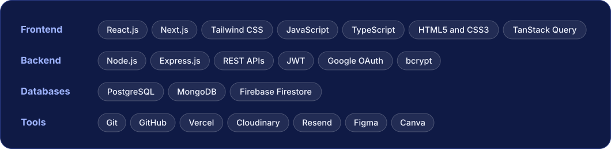
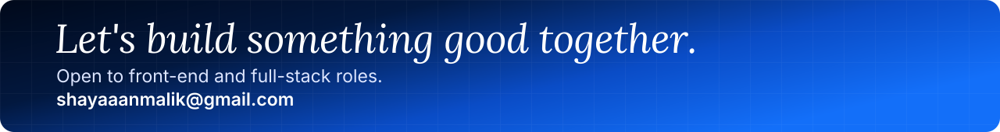

  

  <a href="mailto:shayaaanmalik@gmail.com">Email</a> &nbsp;/&nbsp;
  <a href="https://linkedin.com/in/shayan-malik-43a93139b">LinkedIn</a> &nbsp;/&nbsp;
  <a href="https://github.com/shayan-malik?tab=repositories">Repositories</a>

 

## About

I'm a front-end developer from Karachi who builds complete products, not just screens. I design the interface, write the API behind it, model the database and deploy it. I'm finishing a MERN Stack course at SMIT and have shipped four projects that are live right now. Each one is below, and each link opens a working app.

 

## Selected work

   
  <a href="https://avenzo-plum.vercel.app/">Live site</a> &nbsp;/&nbsp; <a href="https://github.com/shayan-malik/avenzo">Frontend code</a> &nbsp;/&nbsp; <a href="https://github.com/shayan-malik/avenzo-ecommerce">Backend code</a>

   
  <a href="https://smxcreators.com/">Live site</a>

   
  <a href="https://hcm-lite-j1rp.vercel.app/">Live site</a> &nbsp;/&nbsp; <a href="https://github.com/shayan-malik/hcm-lite">Code</a>

   
  <a href="https://login-user-2b797.web.app/">Live site</a>

 

## What I work with

  

 

  

